<h1 align="center">Gonzalo Cabezas Núñez</h1>

## 🇬🇧 FULLSTACK WEB DEVELOPER

Developer focused on modular software architectures, secure web applications, multilingual systems and performance-oriented development.

I enjoy building maintainable applications with lightweight vanilla-first approaches, reusable components, strong security practices and clean separation of concerns.

Currently exploring blockchain development with Solidity and deepening my cybersecurity knowledge with a growing interest in Red Teaming.

### Technical Focus

- Modular software architectures
- Secure backend integrations
- Web performance optimization
- Internationalization (i18n) systems
- Component-driven frontend design
- Accessibility and semantic HTML
- Content Security Policy hardening

### Areas of Interest

- Cybersecurity
- Blockchain Development
- Privacy and Digital Integrity
- Open Source Engineering
- Data Analytics

<h3 align="center">Core Stack</h3>
<div align="center">
    
    
    
    
    
    
</div>

<h3 align="center">Open Source Contributions</h3>

<div align="center">
    
</div>

- [github/choosealicense.com #1401](https://github.com/github/choosealicense.com/pull/1401) — Added GNU LGPLv3 summaries in five languages: Arabic, Spanish, Korean, Portuguese and Simplified Chinese.

<h3 align="center">GitHub Metrics</h3>
<div align="center">
    <!-- TOP LANGS -->
    
    <!-- GH STATS -->
    
</div>

#### Would you prefer to send me a secure email?

<details>
<summary>🔒 PGP Public Key</summary>

```txt
-----BEGIN PGP PUBLIC KEY BLOCK-----

mQINBGj6lSgBEADZ906d+12QMrIWnn1rST3GTgBQpM85QwOcDvrSell9OamxHk9Y
Nh+YfdRT/ozvQe3hFsqNcUJX21Kua3+Qx+7EdIxZ+WKOvzJ999jM/xBF9O/ZUqRG
MEIlXrE7cuOOhlNi9sMhsf/mcrEj0jZ049EVIdzRnBZOOn3kbTZ8zIxVDvIxfirD
NDsLh4IRWM8OKxYamgPfYwTvgikkFQnNmdb8kSzeYhypabs54QwLxu9aw2Ce0TLt
xxMMT72sW9JgQ/dmWqe+WOXDgs6DT2vyv9X0fORASjeMo6pELLRo7YPdr4LT0oLO
bXeALKiFvJFWUL6jwilIRcMt/CZ8z/NvfDiJndUn3i6oVC78Il2q2gVUbjT5HRZM
TQUmG5hHMLuyqSSLyL9wn3neUulfNHLsY1bwLxMqR4ZanX+9Fq3ODU+ioxSIO8lK
0kST0hKdjmZRmtwM3IWAmbFjGb5PjE23tHHvPG73co+Qnr54jdP17DV5HHeH3pcs
/nUo5XJQZobWBIx6AuwbgNi4gsAxsfCkiJtYXotR7nsxrnjpyivXNdu1lAcSFxnw
il2NxoiLLBvMX9EeeHBuoVLvyjcLYIYJQd9sb5pIevFQgP5uwIuXUVKnYyvvp3/9
SQmO6wtlW03J6bghbeNyWaPm4ldeiEyLU6/bR1Up/+SSCN8moTZBYFaKEwARAQAB
tCpHb256YWxvIENhYmV6YXMgTsO6w7FleiA8ZGV2QHNhbmRva2FuLmNhdD6JAkcE
EwEIADEWIQTlHKaRLf/Vk4B38nC/PFQGvgp8MAUCaPqVKgIbAwQLCQgHBRUICQoL
BRYCAwEAAAoJEL88VAa+Cnwwb9sQAMWOmBFx4CeEUm7cKo1P0GTCzqT+BfCRu46S
tTOj22ofQeFVvkxPrGBGtyIpyIOHGCQIisKWqL3DCvwxsXiWGCT5TL3yQF+xN5YX
h8lL+dNe9AJPaxEBnFfxiZ93uLt3nNR+F6UkYqr11lr49qjEr0RCjHxZE8Nqw/uK
3cib5LvFnSCwT8KawCDqiqB1YoJEjUxgixFdr92D5X87vsWcODydgiwqZa+Dnptc
JEljYrSam6b8/oDuVrluR6YR21PyzMUaWqKhyBgnBdZvv+PBLel89cjD3e3GQhpr
SU6P8uHFIv8ydVNGrsroM3HLGYZNLyorl94F0XO1L7xigvtshv2fkGJHIsyL7xOS
W8lhLTsjo6Z+kibPyYcQsaE71iMtu+jYu3CN+UTrZaNcUztIPM9sawNy6pgC5QjM
LwR7STukDH2xXh+Jr/rJ0jI1Agcmwqfe2sGQQW5FxcaJsTJMqgFF4Y4y/YcpN6zm
ImfFQ/kGXo0XHUPGOhH4yKHohLB27On4vk4L7vg8f11ah742WmOG9QahwA6Fj5VZ
O1QumldiFzWkgX25L2Z/cunpAPOoexRoOoFnIIYrz5ND7UlL3LTkcwBNAE52PZ7Q
Pvr0ADVFSbbH2DpmHKejY1/B6Y9ZX/Ox8ovMEZlWwkUiId4GKnyyHW+ZJjb4jnY3
v92X6pwEuQINBGj6lSoBEADTuqqh2Qg+R3bFNPst+nVscbf1OUgZc+njYq9YKziF
cFw6APy5tyJoPuP662WZJgc2ycgjL7R3BvhvUMsCh167ho197lZHngQtFa3wFd19
63E69khAudlPU22a1tDRZePLHDgbA55KFSbJ4W4Tuli5LhkNJszzyBn2v6X8fa3G
aHULJBmGDUpQLr2hmg13wgj5112sIepmwkBLL6A5t7ncXGSZT3Lgugw3U8OY88Fq
HrISSwxHyhsV7tYJH9sPmv0oLWSAoQgXKe/zhQShJQ/sUNigsbpQl6kw9y5vhG1+
Cj1VAr7UdqujI/txXKa0Sg2mXZ/hsrmK9ZLaQBc7qDqNkaTnn64GAtYOpLqB5Z3x
EulXnkb0IaOrPP+y32/8iX99li0VzuhEWZKCqVAQh5/bCC5Q4qtFGFTPk6BrWNzW
4xW2CKAWtY+ZvrNrWetnZkKDgUiMIE9QJHFBxL5vj5pXFmiBID6pS53NP2LYJChT
wI9lp/wpmsA2qrJbOwBZhMRVNzX99Z5tNHtzemACh1vi38FqHvX+m7UvMsQcZkun
yjF8RX62L/N2lue424raNmHCwMgRMzQlHb5I8JHRcc8ueKFxK8qr4wbOvKya9N+V
AZ3+/H7rv1OGx+GslKAGI4gOV1LeJ9PZxsi42iDZWnWMZE+Jml+SJLvte0wzIYGD
6QARAQABiQI2BBgBCAAgFiEE5RymkS3/1ZOAd/JwvzxUBr4KfDAFAmj6lSsCGwwA
CgkQvzxUBr4KfDCVaxAAxxHhL7MiglPdpUqxNHbNcTUb3duFbn4oFU6+HnwIgQ64
b3JLl5HDSA/nWpjPuC+Ygvkzzqg+l9X6B6aKaBqIgHyRO1Y7LVuSposf/bSW1GpT
AF2jrGjEwutd+J9NCfJ94VO7PaQRbOCPgp/9xgMt6S7ERSIAjXxOG1BilzIyNOHp
1CMG9kmi68JkejEfTp8rn404PZ54Y+yBOFYBcqsc7Ug6vrONmflcGvP7UNgExvMV
DLQhEub/oZwI0wNt3+uic9Tz4qQ1qQ3GRE7HSpb7evKfPN+A8xPn3sg3R3hp+4nE
OYCGma4MMVheWMi6CV9IN3/woCqZakgxjCQzrZRpDMAbYxkb8vealLYNAxLmciDP
kNGDQPitr/UmWk231HPxejLq3EiWq9zPNX2ALqdiyaEprthmSaWs6L6xEyRH3KcG
iwemVDP/tgJ7pTXN4Y+w6ruiMaXyj8Zc/jsR/fa1zksS/f+pAbD6qMjvmI4Y5Vnl
Gwd0Pd42/wudeC2aQRGht46DooKDFRy9/0msavTtWTtsfDQlp9b1i1MZ8yOHaYl+
J5f2VFyLzRM/SAh+3/iyYrQWVydbXY3p8hqC2vjs5DVIOHCrIIftgSlriXyKBCtj
UF0qo2+8sj9RhdKgjOaR2TKcmDKnw5fHFANtA/JBWnUYmGyu7bwBq7t/44DePUU=
=GRBi
-----END PGP PUBLIC KEY BLOCK-----
```

</details>

---

#### [StackOverflow Activity](https://stackoverflow.com/users/33241929/sandokan-cat)
<!-- STACKOVERFLOW:START -->
<!-- STACKOVERFLOW:END -->

---

<details>
<summary>🇪🇸 Español</summary>

## DESARROLLADOR WEB FULLSTACK

Desarrollador centrado en arquitecturas de software modulares, aplicaciones web seguras, sistemas multilingües y desarrollo orientado al rendimiento.

Disfruto creando aplicaciones mantenibles con enfoques vanilla-first ligeros, componentes reutilizables, prácticas de seguridad sólidas y una separación clara de responsabilidades.

Actualmente estoy explorando el desarrollo blockchain con Solidity y ampliando mis conocimientos en ciberseguridad, con un interés creciente en Red Teaming.

### Enfoque Técnico

- Arquitecturas de software modulares
- Integraciones backend seguras
- Optimización del rendimiento web
- Sistemas de internacionalización (i18n)
- Diseño frontend basado en componentes
- Accesibilidad y HTML semántico
- Endurecimiento de políticas Content Security Policy (CSP)

### Áreas de Interés

- Ciberseguridad
- Desarrollo Blockchain
- Privacidad e Integridad Digital
- Ingeniería Open Source
- Análisis de datos

</details>

---

<details>
<summary>🇦🇩 Català</summary>

## DESENVOLUPADOR WEB FULLSTACK

Desenvolupador centrat en arquitectures de programari modulars, aplicacions web segures, sistemes multilingües i desenvolupament orientat al rendiment.

Gaudeixo creant aplicacions mantenibles amb enfocaments vanilla-first lleugers, components reutilitzables, pràctiques de seguretat sòlides i una separació clara de responsabilitats.

Actualment estic explorant el desenvolupament blockchain amb Solidity i ampliant els meus coneixements en ciberseguretat, amb un interès creixent pel Red Teaming.

### Enfocament Tècnic

- Arquitectures de programari modulars
- Integracions backend segures
- Optimització del rendiment web
- Sistemes d’internacionalització (i18n)
- Disseny frontend basat en components
- Accessibilitat i HTML semàntic
- Enduriment de polítiques Content Security Policy (CSP)

### Àrees d’Interès

- Ciberseguretat
- Desenvolupament Blockchain
- Privacitat i Integritat Digital
- Enginyeria Open Source
- Anàlisi de dades

</details>

---

<details>
<summary>🇷🇺 Русский</summary>

## FULLSTACK ВЕБ-РАЗРАБОТЧИК

Разработчик, специализирующийся на модульных программных архитектурах, безопасных веб-приложениях, многоязычных системах и разработке, ориентированной на производительность.

Мне нравится создавать поддерживаемые приложения с использованием лёгких vanilla-first подходов, переиспользуемых компонентов, надёжных практик безопасности и чёткого разделения ответственности.

В настоящее время изучаю blockchain-разработку с использованием Solidity и углубляю знания в области кибербезопасности, проявляя всё больший интерес к Red Teaming.

### Техническая Специализация

- Модульные программные архитектуры
- Безопасные backend-интеграции
- Оптимизация веб-производительности
- Системы интернационализации (i18n)
- Компонентно-ориентированный frontend
- Доступность и семантический HTML
- Усиление политик Content Security Policy (CSP)

### Области Интересов

- Кибербезопасность
- Blockchain-разработка
- Конфиденциальность и цифровая целостность
- Open Source инженерия
- Аналитика данных

</details>

---

<details dir="rtl">
<summary>🇸🇦 العربية</summary>

## FULLSTACK مطوّر ويب

مطور يركز على البنى البرمجية المعيارية، وتطبيقات الويب الآمنة، والأنظمة متعددة اللغات، والتطوير الموجّه نحو الأداء.

أستمتع ببناء تطبيقات قابلة للصيانة باستخدام أساليب vanilla-first خفيفة، ومكونات قابلة لإعادة الاستخدام، وممارسات أمنية قوية، مع فصل واضح للمسؤوليات.

أستكشف حالياً تطوير البلوكشين باستخدام Solidity، وأعمل على تعميق معرفتي بالأمن السيبراني مع اهتمام متزايد بمجال Red Teaming.

### التركيز التقني

- بنى برمجية معيارية
- تكاملات Backend آمنة
- تحسين أداء الويب
- أنظمة التدويل (i18n)
- تصميم واجهات أمامية قائم على المكونات
- إمكانية الوصول وHTML الدلالي
- تعزيز سياسات Content Security Policy (CSP)

### مجالات الاهتمام

- الأمن السيبراني
- تطوير البلوكشين
- الخصوصية والسلامة الرقمية
- هندسة البرمجيات مفتوحة المصدر
- تحليل البيانات

</details>

---

<details>
<summary>🇨🇳 中文（简体）</summary>

## FULLSTACK 全栈网页开发者

专注于模块化软件架构、安全 Web 应用、多语言系统以及性能导向开发的开发者。

我喜欢使用轻量化的 vanilla-first 方法、可复用组件、严格的安全实践以及清晰的职责分离来构建易于维护的应用程序。

目前正在探索 Solidity 区块链开发，并持续深入学习网络安全，对 Red Teaming 方向也越来越感兴趣。

### 技术方向

- 模块化软件架构
- 安全的 Backend 集成
- Web 性能优化
- 国际化（i18n）系统
- 基于组件的前端设计
- 无障碍与语义化 HTML
- Content Security Policy（CSP）安全策略加固

### 兴趣领域

- 网络安全
- 区块链开发
- 隐私与数字完整性
- 开源工程
- 数据分析

</details>

---

#### ⚖️ Licensing

>- 🖼️ SVG badges inside the [`/badges/`](https://github.com/sandokanCat/.github/tree/main/skills) directory are licensed under the <a href="https://github.com/sandokanCat/.github/blob/main/badges/LICENSE"></a>.
>- 👤 Unless otherwise stated, all remaining repository content is proprietary and all rights are reserved. © [sandokan.cat](https://sandokan.cat)

```py
# KEEP LEARNING ⚡
while True:
    study()
    build()
    improve()
```
